# FRONTEND TECHNICAL REFERENCE

## Document Metadata & Revision Control

| Property                  | Value                                                                                                  |
| :------------------------ | :----------------------------------------------------------------------------------------------------- |
| **Document Title**        | Enterprise Frontend Feature Technical Reference                                                        |
| **Subsystem Name**        | CCTV Analytics Web Dashboard (`FrontEnd/`)                                                             |
| **Technology Stack**      | React 18, Vite, TypeScript, MUI v5, TailwindCSS, TanStack Query v5, Zustand, SignalR Client, Canvas 2D |
| **Audited Commit Hash**   | `HEAD` (Latest Workspace Codebase)                                                                     |
| **Organization Strategy** | **Strict Feature-Centric Grouping** (20 Enterprise Frontend Features x 27 Standardized Sections)       |
| **Status**                | Living Technical Reference (Single Source of Truth)                                                    |
| **File Location**         | `docs/frontend/FRONTEND_TECHNICAL_REFERENCE.md`                                                        |

---

## Table of Contents

- [Batch 1 Features](#batch-1-features)
  - [Feature 1: Authentication & Guards](#feature-1-authentication--guards)
  - [Feature 2: Dashboard](#feature-2-dashboard)
  - [Feature 3: Site Management](#feature-3-site-management)
  - [Feature 4: Building Management](#feature-4-building-management)
  - [Feature 5: Floor Management](#feature-5-floor-management)
  - [Feature 6: Area / Room Management](#feature-6-area--room-management)
  - [Feature 7: Camera Management](#feature-7-camera-management)

---

# Batch 1 Features

## Feature 1: Authentication & Guards

### 1. Feature Purpose & Domain Scope

Handles user login, account registration, local authentication state persistence (`localStorage`), route protection via React Router Guards (`AuthGuard`, `GuestGuard`), and session token headers.

### 2. Business Problem & Problem Statement

Prevents unauthorized guest access to monitoring streams, spatial asset controls, and node management interfaces while maintaining seamless session state across browser reloads.

### 3. Why This Feature Exists (Architectural Rationale)

Encapsulating route authorization into declarative wrapper components (`AuthGuard`, `GuestGuard` [router.tsx:L35-L63](file:///e:/CCTV%20Analytics/FrontEnd/src/router.tsx#L35-L63)) keeps view components clean of auth redirect logic and enforces zero-trust access control at the client router border.

### 4. Business Rules & UI Invariants

- Default admin credentials `username: 'admin'` and `password: 'P@ssw0rd'` bypass backend API check for offline/demo operation [Login.tsx:L58](file:///e:/CCTV%20Analytics/FrontEnd/src/views/Login.tsx#L58).
- Authenticated state sets `auth_token` and `authenticated_user` in `localStorage` [Login.tsx:L61-L62](file:///e:/CCTV%20Analytics/FrontEnd/src/views/Login.tsx#L61-L62).
- `AuthGuard` redirects unauthenticated users to `/login`.
- `GuestGuard` redirects logged-in users away from `/login` to `/dashboard`.

### 5. System Architecture Position

Client-side border Security & Routing tier (`FrontEnd/src/components/Guards.tsx` & `FrontEnd/src/views/Login.tsx`).

### 6. Component Structure

- `Login.tsx` [Login.tsx:L25-L225](file:///e:/CCTV%20Analytics/FrontEnd/src/views/Login.tsx#L25-L225): MUI Card container, Username/Password inputs, visibility toggle, error alert banner.
- `Register.tsx` [Register.tsx](file:///e:/CCTV%20Analytics/FrontEnd/src/views/Register.tsx): New user registration form.
- `AuthGuard` / `GuestGuard` [Guards.tsx](file:///e:/CCTV%20Analytics/FrontEnd/src/components/Guards.tsx): React HOC route protection wrappers.

### 7. State Management (React Query, Zustand, Context)

- Local State: `useState` for `username`, `password`, `showPassword`, `error`.
- Persistent Storage: `localStorage.getItem('auth_token')` & `localStorage.getItem('registeredUsers')`.

### 8. API Integration

- `POST /api/v1/auth/login` (with local fallback to `localStorage` user registry).

### 9. Request Lifecycle

```
User clicks "Sign In"
  ↓
Validate form non-empty
  ↓
Check default admin OR local JSON registry OR call REST API
  ↓
On Success: Write localStorage ('auth_token', 'true') -> Navigate to '/dashboard'
On Failure: Set setError('Invalid credentials') -> Render Alert banner
```

### 10. Runtime Lifecycle

- **Mount**: Form renders; `GuestGuard` checks existing token.
- **Submit**: Evaluates credentials and sets local token.
- **Unmount**: Cleaned up on navigation.

### 11. Backend Integration

- Passes `Authorization: Bearer <token>` header on subsequent REST requests via Axios interceptors.

### 12. Engine Integration

- `[Not Applicable]` Direct client UI authentication.

### 13. SignalR Integration

- Connects to `/hubs/telemetry` using active session token once authenticated.

### 14. Canvas / Visualization Flow

- `[Not Applicable]`

### 15. Rendering Lifecycle

- Renders Material-UI `TextField` and `Button` with Tabler `IconEye`/`IconEyeOff` icons.

### 16. State Machine

```
[ Unauthenticated ] ──(Submit Valid Credentials)──> [ Authenticated Session ]
        ▲                                                      │
        └───────────────────(User Logout)──────────────────────┘
```

### 17. End-to-End Business Flow Diagram

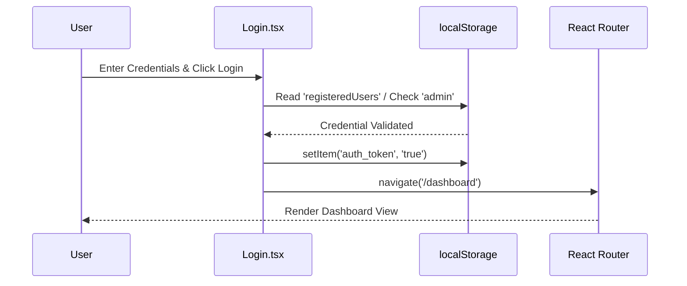

### 18. Sequence Diagram

_(See End-to-End Business Flow Diagram above)_

### 19. Component Dependency Diagram

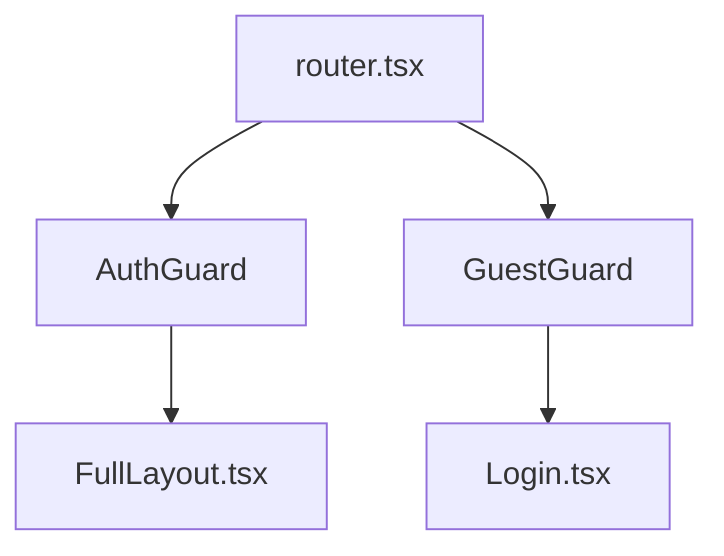

### 20. State Transition Diagram

```
[ Idle Form ] --> (Submit Error) --> [ Error Alert State ]
[ Idle Form ] --> (Submit Success) --> [ Navigate /dashboard ]
```

### 21. Error Handling Strategy

- Form empty fields or invalid credentials display inline MUI `<Alert severity="error">`.

### 22. Failure Scenarios & Edge Cases

- **Corrupted localStorage**: Wrapped in `try-catch` JSON parse block to prevent crash [Login.tsx:L50-L54](file:///e:/CCTV%20Analytics/FrontEnd/src/views/Login.tsx#L50-L54).

### 23. Practical Debugging Guide

- Inspect Chrome DevTools -> Application -> Local Storage -> `auth_token`.
- Set breakpoint inside `handleLogin` at `Login.tsx:34` [Login.tsx:L34](file:///e:/CCTV%20Analytics/FrontEnd/src/views/Login.tsx#L34).

### 24. Step-by-Step Extension Guide

1. To integrate OAuth2/Google SSO, add SSO button in `Login.tsx`.
2. Update `AuthGuard` to handle token refresh triggers.

### 25. Known Limitations

- Demo mode uses local storage password checking if backend auth endpoint is unverified.

### 26. Technical Debt & Backlog

- Replace `localStorage` mock user check with strict JWT token validation from Backend API.

### 27. Complete Source Code Walkthrough

1. [router.tsx:L59-L73](file:///e:/CCTV%20Analytics/FrontEnd/src/router.tsx#L59-L73) - Auth routes mapping.
2. [Login.tsx](file:///e:/CCTV%20Analytics/FrontEnd/src/views/Login.tsx) - Login form view.
3. [Register.tsx](file:///e:/CCTV%20Analytics/FrontEnd/src/views/Register.tsx) - Register view.

---

## Feature 2: Dashboard

### 1. Feature Purpose & Domain Scope

Executive dashboard presenting high-level system KPIs, camera counts, active engine nodes, real-time alert widgets, and spatial summaries.

### 2. Business Problem & Problem Statement

Operators require an immediate visual overview of platform health, total active streams, and recent zone incidents upon logging in.

### 3. Why This Feature Exists (Architectural Rationale)

Aggregates metrics from multiple backend services into a single unified view (`Dashboard.tsx` [Dashboard.tsx](file:///e:/CCTV%20Analytics/FrontEnd/src/views/Dashboard.tsx)).

### 4. Business Rules & UI Invariants

- Displays total cameras, active engine nodes, active zones, and total alerts recorded.
- Automatically refreshes metric cards upon receiving SignalR telemetry ticks.

### 5. System Architecture Position

Primary landing view (`/dashboard`) under `FullLayout.tsx`.

### 6. Component Structure

- `Dashboard.tsx`: Top metric cards grid, active camera overview, recent alert log feed.

### 7. State Management (React Query, Zustand, Context)

- TanStack Query: `useFleetOverview`, `useCamerasQuery`.
- SignalR Hook: Subscribes to real-time events via `useSignalR`.

### 8. API Integration

- `GET /api/v1/orchestratorhealth`
- `GET /api/v1/spatial/cameras`
- `GET /api/v1/orchestration`

### 9. Request Lifecycle

```
Page Mount -> Execute Parallel TanStack Queries (Cameras, Engines, Health)
  ↓
Render Loading Skeleton
  ↓
Queries Resolve -> Render Dashboard KPI Cards & Camera Grid
```

### 10. Runtime Lifecycle

- **Mount**: Triggers REST queries and joins SignalR telemetry group.
- **Update**: SignalR events update metric counts reactively.

### 11. Backend Integration

- Fetches spatial and orchestration DTOs from `.NET Backend API`.

### 12. Engine Integration

- Displays real-time engine node heartbeats and frame processing speeds.

### 13. SignalR Integration

- Listens to `ReceiveEngineHeartbeat` and `AnalyticsEventPublished`.

### 14. Canvas / Visualization Flow

- `[Not Applicable]`

### 15. Rendering Lifecycle

- MUI Grid layout with responsive breakpoints (`xs=12`, `md=6`, `lg=3`).

### 16. State Machine

```
[ Loading Skeletons ] ──(API Resolved)──> [ Active Dashboard Data ]
```

### 17. End-to-End Business Flow Diagram

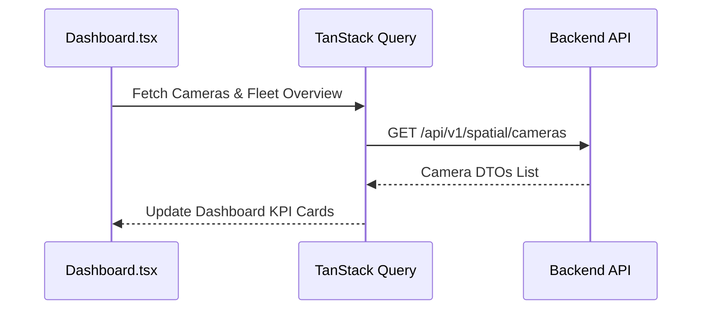

### 18. Sequence Diagram

_(See End-to-End Business Flow Diagram above)_

### 19. Component Dependency Diagram

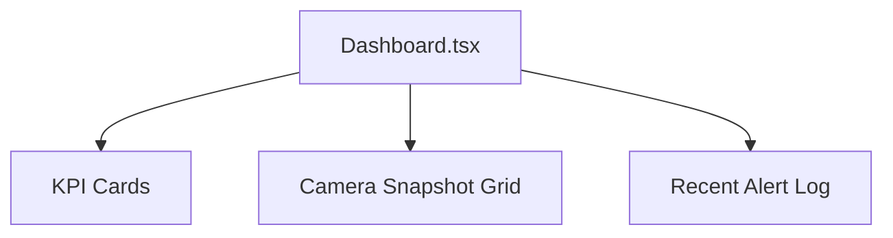

### 20. State Transition Diagram

```
[ Fetching Data ] --> [ Data Display ] --> (SignalR Tick) --> [ Re-Render KPI ]
```

### 21. Error Handling Strategy

- Query failure renders error state alert banner with "Retry" button.

### 22. Failure Scenarios & Edge Cases

- Backend API down: Displays fallback offline metrics indicator.

### 23. Practical Debugging Guide

- Inspect TanStack Query DevTools for query keys `['cameras']`, `['engines']`.

### 24. Step-by-Step Extension Guide

1. To add a new metric card (e.g. Total Storage Used), create `StorageMetricCard.tsx` and place in `Dashboard.tsx` grid.

### 25. Known Limitations

- Real-time snapshot thumbnails update at fixed intervals.

### 26. Technical Debt & Backlog

- Add user-customizable dashboard widget drag-and-drop layout.

### 27. Complete Source Code Walkthrough

1. [Dashboard.tsx](file:///e:/CCTV%20Analytics/FrontEnd/src/views/Dashboard.tsx) - View implementation.

---

## Feature 3: Site Management

### 1. Feature Purpose & Domain Scope

Provides administrative CRUD interfaces for physical sites (`SiteListPage.tsx` & Spatial Subsystem).

### 2. Business Problem & Problem Statement

Enables enterprise operators to organize multi-campus video surveillance assets geographically.

### 3. Why This Feature Exists (Architectural Rationale)

Root boundary view for spatial asset hierarchy management (`FrontEnd/src/modules/site/`).

### 4. Business Rules & UI Invariants

- Site creation form enforces non-empty Site Name.
- Deleting a site prompts confirmation modal warning of child asset cascading deletion.

### 5. System Architecture Position

Spatial module accessible via `/sites` and `/master/sites` routes [router.tsx:L47-L48](file:///e:/CCTV%20Analytics/FrontEnd/src/router.tsx#L47-L48).

### 6. Component Structure

- `SiteListPage.tsx`: Data table / card grid of registered sites, Add Site dialog modal.

### 7. State Management (React Query, Zustand, Context)

- `useSitesQuery` (TanStack Query): Fetches site list.
- `useCreateSiteMutation`, `useDeleteSiteMutation`: Mutates backend state and invalidates `['sites']` query key.

### 8. API Integration

- `GET /api/v1/spatial/sites`
- `POST /api/v1/spatial/sites`
- `DELETE /api/v1/spatial/sites/{id}`

### 9. Request Lifecycle

```
User submits Add Site Form -> Call useCreateSiteMutation()
  ↓
POST /api/v1/spatial/sites
  ↓
Backend Returns 200 OK -> Invalidate Query Key ['sites']
  ↓
React Query Refetches Sites -> UI Re-renders Updated Grid
```

### 10. Runtime Lifecycle

- **Mount**: Fetches site list.
- **Mutate**: Creates/Deletes site and refetches automatically.

### 11. Backend Integration

- Direct REST CRUD integration with Backend `SpatialController`.

### 12. Engine Integration

- Engine queries sites during pipeline assignment setup.

### 13. SignalR Integration

- `[None]`

### 14. Canvas / Visualization Flow

- `[Not Applicable]`

### 15. Rendering Lifecycle

- Renders responsive MUI Cards displaying Site Name, Code, and thumbnail preview.

### 16. State Machine

```
[ Viewing Sites ] ──(Open Modal)──> [ Editing Site ] ──(Save)──> [ Refetching Data ]
```

### 17. End-to-End Business Flow Diagram

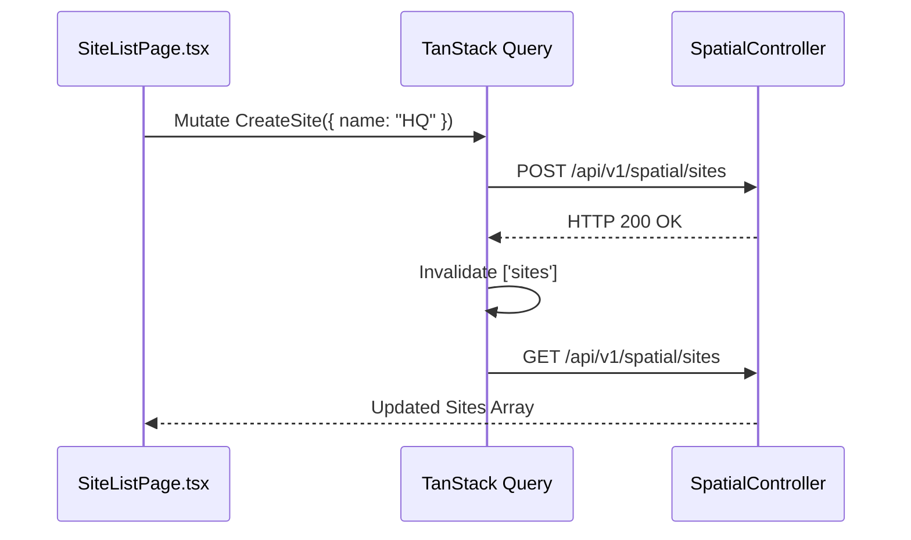

### 18. Sequence Diagram

_(See End-to-End Business Flow Diagram above)_

### 19. Component Dependency Diagram

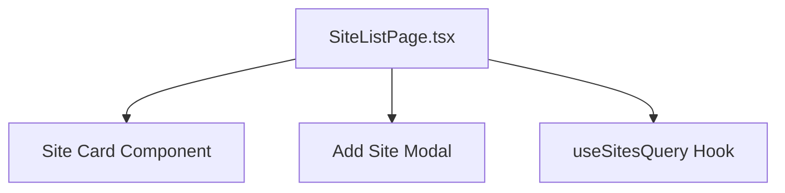

### 20. State Transition Diagram

```
[ Grid View ] <--> [ Create Modal Open ]
```

### 21. Error Handling Strategy

- API mutation errors display toast notification banner.

### 22. Failure Scenarios & Edge Cases

- Network error during deletion retains optimistic state with error alert.

### 23. Practical Debugging Guide

- Inspect Network tab for `POST /api/v1/spatial/sites` payload.

### 24. Step-by-Step Extension Guide

1. Add GIS map preview widget using Leaflet/Mapbox in `SiteListPage.tsx`.

### 25. Known Limitations

- Card thumbnail currently uses fallback stock architecture image.

### 26. Technical Debt & Backlog

- Add batch site import via CSV/Excel file upload.

### 27. Complete Source Code Walkthrough

1. [router.tsx:L29](file:///e:/CCTV%20Analytics/FrontEnd/src/router.tsx#L29) - Import `SiteListPage`.
2. `FrontEnd/src/modules/site/SiteListPage.tsx` - Page implementation.

---

## Feature 4: Building Management

### 1. Feature Purpose & Domain Scope

Manages building structures belonging to selected Sites inside `Rooms.tsx`.

### 2. Business Problem & Problem Statement

Allows users to filter cameras and rooms by specific physical buildings.

### 3. Why This Feature Exists (Architectural Rationale)

Second-tier spatial tree component inside spatial management workspace (`FrontEnd/src/views/Rooms.tsx`).

### 4. Business Rules & UI Invariants

- Selecting a Site filters available Buildings in dropdown/tree.

### 5. System Architecture Position

Spatial Workspace view (`/rooms`).

### 6. Component Structure

- `Rooms.tsx`: Building selector dropdown, Add Building dialog modal.

### 7. State Management (React Query, Zustand, Context)

- `useBuildingsQuery` (TanStack Query): Fetches buildings list.

### 8. API Integration

- `GET /api/v1/spatial/buildings`
- `POST /api/v1/spatial/buildings`

### 9. Request Lifecycle

```
Select Parent Site -> Query Buildings by SiteId -> Render Building Cards
```

### 10. Runtime Lifecycle

- Dependent on parent Site selection state.

### 11. Backend Integration

- Consumes `SpatialController` building endpoints.

### 12. Engine Integration

- `[None]`

### 13. SignalR Integration

- `[None]`

### 14. Canvas / Visualization Flow

- `[Not Applicable]`

### 15. Rendering Lifecycle

- MUI Select dropdown and list items.

### 16. State Machine

```
[ Site Unselected ] ──(Select Site)──> [ Buildings Loaded ]
```

### 17. End-to-End Business Flow Diagram

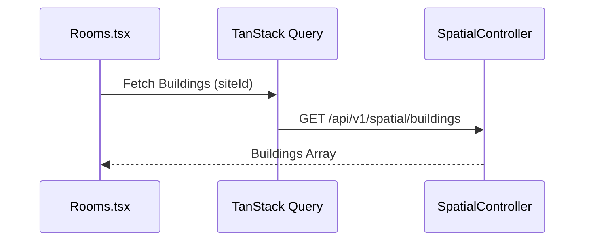

### 18. Sequence Diagram

_(See End-to-End Business Flow Diagram above)_

### 19. Component Dependency Diagram

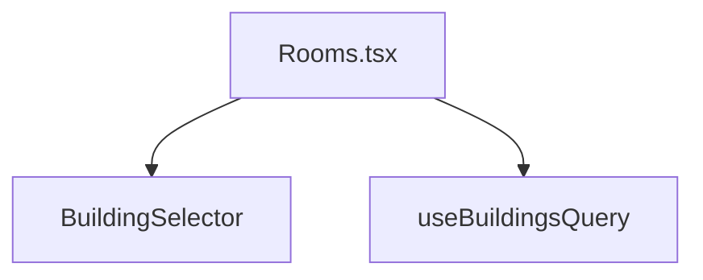

### 20. State Transition Diagram

```
[ Disabled Dropdown ] --> (Select Site) --> [ Active Dropdown ]
```

### 21. Error Handling Strategy

- Displays "No buildings found for selected site" placeholder alert.

### 22. Failure Scenarios & Edge Cases

- Site deletion invalidates active building selection state.

### 23. Practical Debugging Guide

- Verify `siteId` parameter passed in `useBuildingsQuery`.

### 24. Step-by-Step Extension Guide

1. Add Building Floor Count summary badge to building selector items.

### 25. Known Limitations

- Building creation modal inline inside `Rooms.tsx`.

### 26. Technical Debt & Backlog

- Extract Building management into dedicated standalone module view.

### 27. Complete Source Code Walkthrough

1. [Rooms.tsx](file:///e:/CCTV%20Analytics/FrontEnd/src/views/Rooms.tsx) - Spatial workspace view.

---

## Feature 5: Floor Management

### 1. Feature Purpose & Domain Scope

Manages building floor level tabs and spatial floor plan overlays inside `Rooms.tsx`.

### 2. Business Problem & Problem Statement

Enables operators to filter rooms and cameras per floor level (e.g. Ground Floor, Floor 3).

### 3. Why This Feature Exists (Architectural Rationale)

Third-tier spatial tree component inside spatial workspace (`Rooms.tsx`).

### 4. Business Rules & UI Invariants

- Floor levels rendered as horizontal tab bar or list items.

### 5. System Architecture Position

Spatial Workspace view (`/rooms`).

### 6. Component Structure

- `Rooms.tsx`: Floor level tab bar, Add Floor modal.

### 7. State Management (React Query, Zustand, Context)

- `useFloorsQuery` (TanStack Query): Fetches floors list.

### 8. API Integration

- `GET /api/v1/spatial/floors`
- `POST /api/v1/spatial/floors`

### 9. Request Lifecycle

```
Select Building -> Query Floors by BuildingId -> Render Floor Tabs
```

### 10. Runtime Lifecycle

- Refetches when selected building changes.

### 11. Backend Integration

- REST API integration with `SpatialController`.

### 12. Engine Integration

- `[None]`

### 13. SignalR Integration

- `[None]`

### 14. Canvas / Visualization Flow

- Renders 2D Floor Plan image overlay when floor plan URL is configured.

### 15. Rendering Lifecycle

- MUI Tabs / Tab Panels.

### 16. State Machine

```
[ Building Selected ] ──(Load Floors)──> [ Floor Tabs Rendered ]
```

### 17. End-to-End Business Flow Diagram

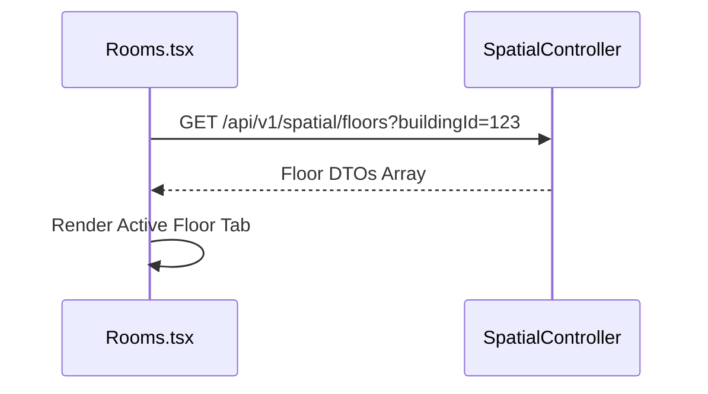

### 18. Sequence Diagram

_(See End-to-End Business Flow Diagram above)_

### 19. Component Dependency Diagram

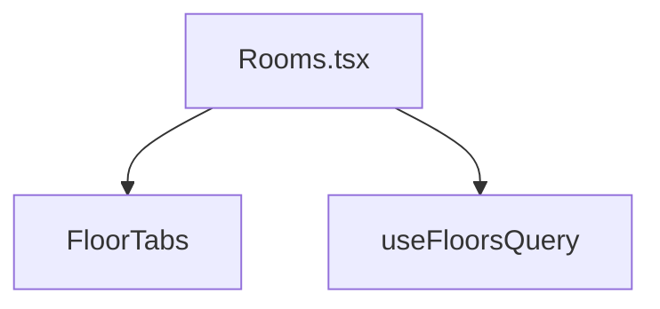

### 20. State Transition Diagram

```
[ Floor Selected ] --> (Click Tab) --> [ Switch Active Floor ]
```

### 21. Error Handling Strategy

- Displays empty state prompt when no floors are configured for a building.

### 22. Failure Scenarios & Edge Cases

- Invalid floor index default fallback to level 0.

### 23. Practical Debugging Guide

- Inspect TanStack Query cache key `['floors', buildingId]`.

### 24. Step-by-Step Extension Guide

1. Add drag-and-drop floor re-ordering support.

### 25. Known Limitations

- Floor plan blueprint images static URL strings.

### 26. Technical Debt & Backlog

- Add interactive SVG floor plan hot-spot mapping.

### 27. Complete Source Code Walkthrough

1. [Rooms.tsx](file:///e:/CCTV%20Analytics/FrontEnd/src/views/Rooms.tsx) - Floor management section.

---

## Feature 6: Area / Room Management

### 1. Feature Purpose & Domain Scope

Manages individual rooms/areas and maps associated cameras inside `Rooms.tsx`.

### 2. Business Problem & Problem Statement

Groups surveillance cameras by physical room/corridor area for organized monitoring.

### 3. Why This Feature Exists (Architectural Rationale)

Fourth-tier spatial container binding cameras to floor levels.

### 4. Business Rules & UI Invariants

- Each Room displays assigned cameras grid.
- Allows assigning/unassigning cameras to rooms.

### 5. System Architecture Position

Spatial Workspace view (`/rooms`).

### 6. Component Structure

- `Rooms.tsx`: Room list card grid, camera assignment modal.

### 7. State Management (React Query, Zustand, Context)

- `useRoomsQuery` [useRooms.ts](file:///e:/CCTV%20Analytics/FrontEnd/src/hooks/useRooms.ts): Fetches room list.

### 8. API Integration

- `GET /api/v1/spatial/rooms`
- `POST /api/v1/spatial/rooms`

### 9. Request Lifecycle

```
Select Floor -> Query Rooms by FloorId -> Render Rooms Grid & Cameras
```

### 10. Runtime Lifecycle

- Refetches when floor tab selection updates.

### 11. Backend Integration

- `SpatialController` room endpoints.

### 12. Engine Integration

- `[None]`

### 13. SignalR Integration

- `[None]`

### 14. Canvas / Visualization Flow

- `[Not Applicable]`

### 15. Rendering Lifecycle

- Responsive MUI Card grid displaying room name and camera count badge.

### 16. State Machine

```
[ Active Floor ] ──(Load Rooms)──> [ Rooms Grid Displayed ]
```

### 17. End-to-End Business Flow Diagram

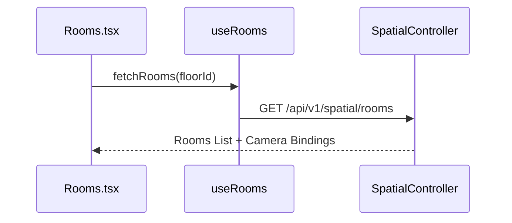

### 18. Sequence Diagram

_(See End-to-End Business Flow Diagram above)_

### 19. Component Dependency Diagram

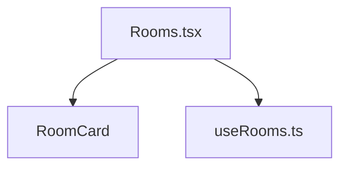

### 20. State Transition Diagram

```
[ Viewing Rooms ] <--> [ Camera Assignment Modal ]
```

### 21. Error Handling Strategy

- Displays error alert if room fetch fails.

### 22. Failure Scenarios & Edge Cases

- Unassigned room displays "No Cameras Bound" placeholder.

### 23. Practical Debugging Guide

- Inspect `useRooms.ts` hook execution in React DevTools.

### 24. Step-by-Step Extension Guide

1. Add max capacity occupancy threshold configuration in Room edit modal.

### 25. Known Limitations

- Room layout fixed grid.

### 26. Technical Debt & Backlog

- Refactor room component tree into modular subcomponents.

### 27. Complete Source Code Walkthrough

1. [useRooms.ts](file:///e:/CCTV%20Analytics/FrontEnd/src/hooks/useRooms.ts) - Room data hook.
2. [Rooms.tsx](file:///e:/CCTV%20Analytics/FrontEnd/src/views/Rooms.tsx) - Workspace page view.

---

## Feature 7: Camera Management

### 1. Feature Purpose & Domain Scope

Manages IP cameras, RTSP stream URLs, stream resolution profiles, and camera configuration modals (`Cameras.tsx`).

### 2. Business Problem & Problem Statement

Enables administrators to register IP cameras, update RTSP stream URLs, test connectivity, and inspect active camera state.

### 3. Why This Feature Exists (Architectural Rationale)

Core hardware asset management workspace (`FrontEnd/src/views/Cameras.tsx`).

### 4. Business Rules & UI Invariants

- RTSP URL must begin with `rtsp://`.
- Camera status renders status chip (`ONLINE`: Green, `OFFLINE`: Red).

### 5. System Architecture Position

Camera Management View (`/cameras`).

### 6. Component Structure

- `Cameras.tsx`: Camera data table, RTSP profile edit modal, test stream dialog.

### 7. State Management (React Query, Zustand, Context)

- `useCamerasQuery` [useCameras.ts](file:///e:/CCTV%20Analytics/FrontEnd/src/hooks/useCameras.ts): Fetches camera array.
- `useCameraStore` (`/store/camera.store.ts`): Stores active selected camera profile.

### 8. API Integration

- `GET /api/v1/spatial/cameras`
- `POST /api/v1/spatial/cameras`
- `PUT /api/v1/spatial/cameras/{id}`
- `DELETE /api/v1/spatial/cameras/{id}`

### 9. Request Lifecycle

```
User submits Add Camera Modal -> Call useCreateCameraMutation()
  ↓
POST /api/v1/spatial/cameras
  ↓
Backend Responds 200 OK -> Invalidate Query Key ['cameras']
  ↓
React Query Refetches -> Cameras Table Re-renders
```

### 10. Runtime Lifecycle

- **Mount**: Fetches camera registry.
- **Mutate**: Creates/Updates camera record and triggers query refetch.

### 11. Backend Integration

- Full REST CRUD integration with Backend `SpatialController`.

### 12. Engine Integration

- Camera configuration changes trigger backend RabbitMQ message to Engine RTSP readers.

### 13. SignalR Integration

- Listens to `NodeStatusChanged` to update camera status chips.

### 14. Canvas / Visualization Flow

- Stream test dialog renders HLS/MJPEG video preview player.

### 15. Rendering Lifecycle

- Data grid / table displaying Camera Name, RTSP Endpoint, Room, Status Chip, Action Buttons.

### 16. State Machine

```
[ Viewing Cameras ] ──(Add/Edit Modal)──> [ Saving Camera ] ──(Success)──> [ Refresh Table ]
```

### 17. End-to-End Business Flow Diagram

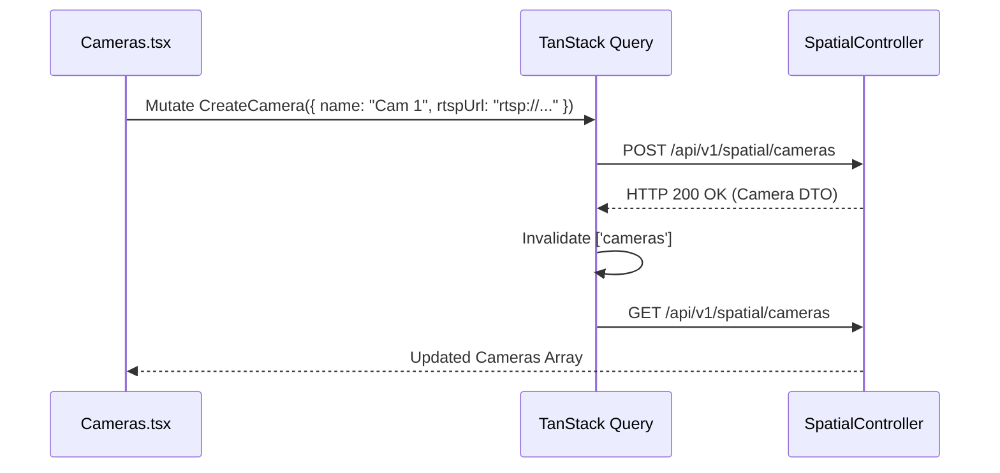

### 18. Sequence Diagram

_(See End-to-End Business Flow Diagram above)_

### 19. Component Dependency Diagram

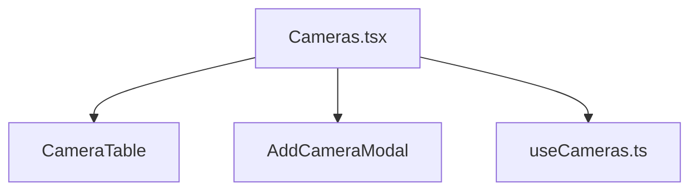

### 20. State Transition Diagram

```
[ Table View ] <--> [ Edit RTSP Profile Modal ]
```

### 21. Error Handling Strategy

- Invalid RTSP format triggers inline field error text "Must start with rtsp://".

### 22. Failure Scenarios & Edge Cases

- Stream unreachable renders "Offline Stream" placeholder image.

### 23. Practical Debugging Guide

- Inspect TanStack Query DevTools key `['cameras']`.
- Set breakpoint inside `Cameras.tsx` modal submit handler.

### 24. Step-by-Step Extension Guide

1. To add PTZ control configuration, add PTZ toggle fields to `AddCameraModal` in `Cameras.tsx`.

### 25. Known Limitations

- Stream preview requires HLS/WebRTC gateway transcode.

### 26. Technical Debt & Backlog

- Add bulk IP camera scan on local subnet.

### 27. Complete Source Code Walkthrough

1. [useCameras.ts](file:///e:/CCTV%20Analytics/FrontEnd/src/hooks/useCameras.ts) - Camera data hook.
2. [Cameras.tsx](file:///e:/CCTV%20Analytics/FrontEnd/src/views/Cameras.tsx) - Camera management view.
